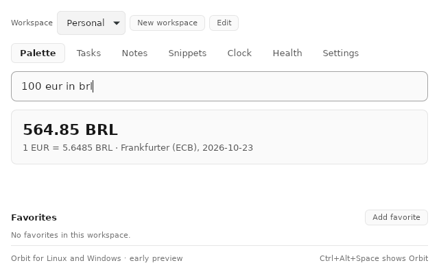
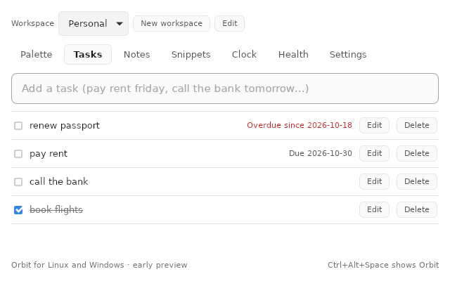
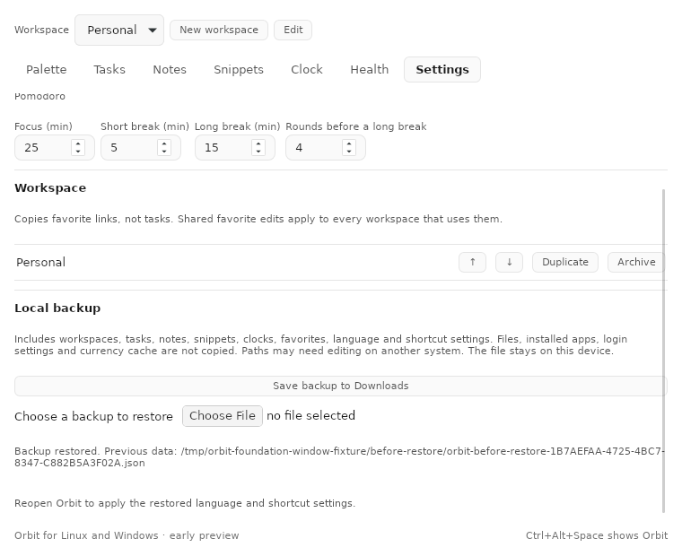

# Orbit

**One app. Many tools. You decide what to focus on.**

A command center for your Mac, built around the idea that you shouldn't open six apps to get one day done. Pick a workspace, and Orbit becomes the thing you are doing right now: your apps and folders, your tasks, your timer, your Mac's health.

[**Download for macOS**](../../releases/latest) · [**Linux 0.2.0 Preview**](https://github.com/carvalhobfr/orbit-releases/releases/tag/desktop-v0.2.0)

**English** · [Português (BR)](README.pt-BR.md)

## Downloads

| Edition | Status | Download |
| --- | --- | --- |
| Orbit for macOS | Stable, macOS 14 or later | [Latest Mac release](https://github.com/carvalhobfr/orbit-releases/releases/latest) |
| Orbit Desktop 0.2.0 for Linux | **Preview** — fewer features than the native Mac app | [Linux downloads and release notes](https://github.com/carvalhobfr/orbit-releases/releases/tag/desktop-v0.2.0) |
| Orbit Desktop for Windows | **Not available yet** | MSI/NSIS builds and extracted-package checks passed; clean installation and real UI acceptance remain pending |

## Orbit Desktop 0.2.0 Preview

The Linux edition has its own version. **0.2.0 is a preview, not feature parity with the native Mac app.** English and Brazilian Portuguese are included. Windows remains a separate draft until clean installation and real interaction are accepted.

| Feature | Preview status | Scope or limitation |
| --- | --- | --- |
| Palette, calculator and currency conversion | Available | Currency uses ECB reference rates and a local cache; a first rate needs a connection |
| Tasks and notes | Available | Add, edit, complete, pin and delete as appropriate; stored locally |
| Timers, pomodoro and world clocks | Available | Desktop notifications; no per-timer sounds or floating countdown |
| System health | Available | Read-only CPU, memory, storage, battery, network and uptime; readings depend on the hardware |
| Snippets | Partial | Copy and fill placeholders; no expansion while typing in other apps |
| File and folder search | Partial | Names in the home folder, with a bounded scan; results can be incomplete; programs and scripts are shown in their folder rather than run |
| Tray, global shortcut and open at login | Partial | Depend on the desktop session; Wayland needs its shortcut portal; real GNOME/KDE acceptance remains pending |
| Voice, AI research, window arrangements and desktop widgets | Not available | These native Mac features are not part of this preview |
| Workspaces and favorites | Available | Create/rename/select/order/duplicate/archive; favorite add/edit/remove/order and explicit opening; switching opens nothing |
| Local backup and restore | Available | Save to Downloads, preview counts, confirm replacement and keep the exact previous data; files/apps/login/cache are excluded |
| Clipboard history, cleanup and device integrations | Not available | Not part of the desktop preview |
| Sync with the Mac app | Not available | The editions keep separate local data |

*Linux captures under Xvfb with fixture tasks and backup data. They show the preview window; real desktop-session acceptance remains pending.*

### Choose a Linux package

Packages are optimized Release builds for the named CPU architecture. Check `uname -m`: use x86_64 for Intel/AMD PCs and arm64 for aarch64/ARM64 machines.

| Architecture | Debian / Ubuntu | Fedora / RPM | Portable AppImage |
| --- | --- | --- | --- |
| x86_64 | [DEB](https://github.com/carvalhobfr/orbit-releases/releases/download/desktop-v0.2.0/Orbit-Desktop-0.2.0-linux-x86_64.deb) | [RPM](https://github.com/carvalhobfr/orbit-releases/releases/download/desktop-v0.2.0/Orbit-Desktop-0.2.0-linux-x86_64.rpm) | Not available in this preview |
| arm64 | [DEB](https://github.com/carvalhobfr/orbit-releases/releases/download/desktop-v0.2.0/Orbit-Desktop-0.2.0-linux-arm64.deb) | [RPM](https://github.com/carvalhobfr/orbit-releases/releases/download/desktop-v0.2.0/Orbit-Desktop-0.2.0-linux-arm64.rpm) | [AppImage](https://github.com/carvalhobfr/orbit-releases/releases/download/desktop-v0.2.0/Orbit-Desktop-0.2.0-linux-arm64.AppImage) |

Download [SHA256SUMS](https://github.com/carvalhobfr/orbit-releases/releases/download/desktop-v0.2.0/SHA256SUMS) next to your package and check it with `sha256sum --ignore-missing -c SHA256SUMS`. These packages are not digitally signed.

### Install the Linux preview

- Debian / Ubuntu: `sudo apt install ./Orbit-Desktop-0.2.0-linux-x86_64.deb` (replace x86_64 with arm64 for that CPU).
- Fedora: `sudo dnf install ./Orbit-Desktop-0.2.0-linux-x86_64.rpm` (replace the architecture when needed).
- ARM64 AppImage: `chmod +x Orbit-Desktop-0.2.0-linux-arm64.AppImage`, then run it. Application favorites also need the host's `gio` utility. It needs a desktop's base libraries and FUSE; when FUSE is unavailable, use `APPIMAGE_EXTRACT_AND_RUN=1 ./Orbit-Desktop-0.2.0-linux-arm64.AppImage`.
- Start **Orbit** from the app menu, or run `orbit-desktop`. The default palette shortcut is **Ctrl+Alt+Space** where the session supports it.

The data file is local, in `~/.local/share/orbit-desktop/`; back up that folder before upgrading. Version 0.2 writes data version 7; the public Linux 0.1 preview cannot read it. Settings exports local JSON backups and previews restoration before confirmation; previous data is copied first. Restore preserves IDs and workspace assignments. Paths may need editing on another OS; native Mac database import and sync are not included. No telemetry or automatic sync. The release notes list the exact package checks and remaining platform limits. The screenshots and feature descriptions below show the **native Mac edition**.

 

<picture>
  <source media="(prefers-color-scheme: dark)" srcset="images/dashboard-dark.png">
  
</picture>

## Your focus, one click away

Orbit is not a single-purpose utility. It is a hub with a lot of rooms, and **you choose which one is open**.

- **Workspaces set the scene.** "Work", "Studio", "Side project": each one is a set of apps, folders and links. Switch workspace and everything you need is a click away. Switching never launches anything by itself.
- **The menu bar panel is yours to arrange.** Drag its blocks into the order you want, remove the ones you don't use, add them back later. It can hold your workspace switcher, favorites, a currency converter, Mac Health readings, a running timer and your clipboard status.
- **A command palette for everything.** Press **⌃⌥Space** and type: jump to a workspace, convert `100 eur in brl`, find a note, add a task, ask the assistant.

<table>
<tr>
<td width="50%" valign="top">
<picture>
  <source media="(prefers-color-scheme: dark)" srcset="images/menubar-dark.png">
  
</picture>
 <b>The menu bar panel</b>, arranged your way
</td>
<td width="50%" valign="top">
<picture>
  <source media="(prefers-color-scheme: dark)" srcset="images/palette-convert-dark.png">
  
</picture>
 <b>The command palette</b>: convert, search, jump
</td>
</tr>
</table>

## What's inside

### Get things done
- **Tasks** with due dates written the way you say them (English and Portuguese), **quick notes** and **snippets**, with export to Obsidian and Apple Notes.
- **Clock**: countdown timers (`25m`, `1h30`, `10:00`), a pomodoro cycle with your own lengths, and world clocks by city.
- **Currency** with daily ECB reference rates, cached for offline use, and exact decimal math (no floating-point rounding).
- **Clipboard history**, opt-in and local.
- **Widgets** for currency, tasks, favorites, an overview and the clock.

### Ask, by text or voice
- A **rule-based assistant** that understands plain English and Portuguese commands, by typing or by voice (hold **⌃⌥V**; recognition runs on the device).
- An optional **AI research panel** (**⌃⌥A**) that can use your **Claude** or **ChatGPT** plan, or your own API keys. AI is off until you turn it on.
- An optional **[Conclave](https://github.com/carvalhobfr/conclave-ai)** companion that opens its local review cockpit for a folder you grant.

### Look after your Mac
- **Live readings**: CPU, memory, storage, battery, network, thermal state.
- **Disk map**: a treemap of your home folder you can walk into, with live progress while it scans and the last map kept to open at once.
- **Clean up safely**: caches and build folders go to the **Trash**, never straight to deletion, and only after you review a preview and confirm.

<picture>
  <source media="(prefers-color-scheme: dark)" srcset="images/health-map-dark.png">
  
</picture>

## Coming in the next release

Already built and being checked before it ships. Not in the current download yet.

- **Devices.** Your iPhone and iPad over a cable or Wi-Fi sync: battery health (charge, cycles, maximum capacity), storage, apps by size with the data each app keeps, the Finder backups on this Mac, an hourly battery and storage history, a battery widget and a menu bar block, and opt-in low and charged notifications. Reading is the default: nothing is installed, copied or paired. Removing an app from the phone is opt-in, asks for a confirmation that names the app and refuses Apple's own apps.
- **Accessories** (opt-in): the charge of your AirPods, Magic Keyboard, Mouse and Trackpad, and game controllers.
- **Mac Health, further:** a checkup (memory pressure, crashes, drive and battery health, and protection checks such as FileVault, firewall, Gatekeeper, updates and Time Machine, each with a plain explanation); a smart scan that tells you where to look first; app sizes, last use, uninstall and update checks (Sparkle, the App Store and Homebrew); startup items and system extensions; duplicates and old large files; disk map search, category filters, a largest-files ranking and external drives.
- **Menu bar and clock:** a "Busiest apps" block, pomodoro presets (Classic 25/5, Deep work 50/10, Sprint 15/3) and a sound for each timer.

## Principles

- **Local first.** Your data stays on your Mac. **No telemetry, no accounts, no analytics.**
- **Read first, change second.** Scans only measure. Anything that removes something is explicit, previewed and, where possible, recoverable from the Trash.
- **Secrets stay in the Keychain**, never in the app's database.
- **Native.** SwiftUI and AppKit, a monochrome design that respects Reduce Motion and Increased Contrast, English and Brazilian Portuguese.

## Install

1. Open the [latest release](../../releases/latest) and download `Orbit-<version>.zip`.
2. Unzip it and move `Orbit.app` to your **Applications** folder.
3. These builds are **not notarized by Apple**, so the first time you open Orbit macOS will refuse. Go to **System Settings → Privacy & Security** and choose **Open Anyway**.

Requires **macOS 14 or later**.

## Good to know

- **Updating:** Orbit tells you when a newer version is published (Settings → Updates) and opens its release page. Download it and replace the app in Applications. Orbit never downloads or installs anything by itself.
- **Permissions are asked for when a feature needs them**: notifications, microphone and Full Disk Access (only to map your whole home folder without prompts). macOS may ask again after an update.
- **Widgets** show "Open Orbit to sync" in these builds, because sharing data with a widget needs an Apple developer team in the signature.

## About this repository

This repository only holds the downloadable builds and this page; the source code is private. Orbit's in-app update check reads the latest release here. Each release lists what changed and how to install it. Screenshots are made from sample data.
