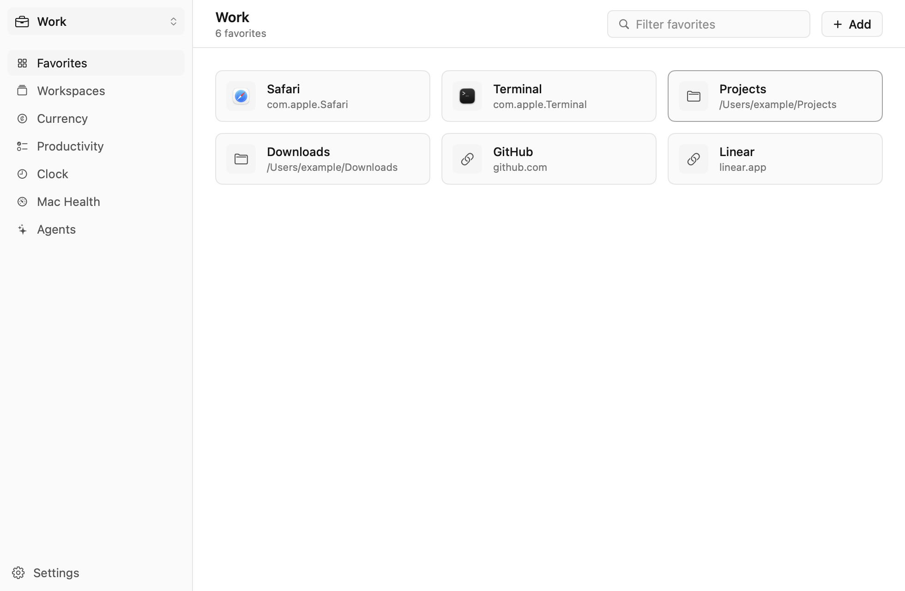
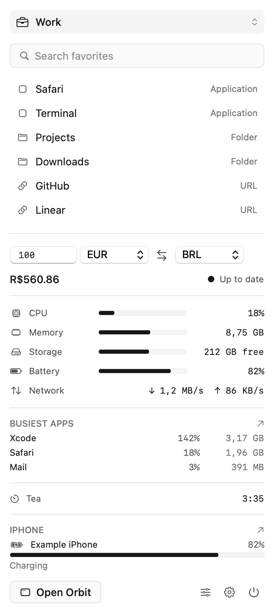
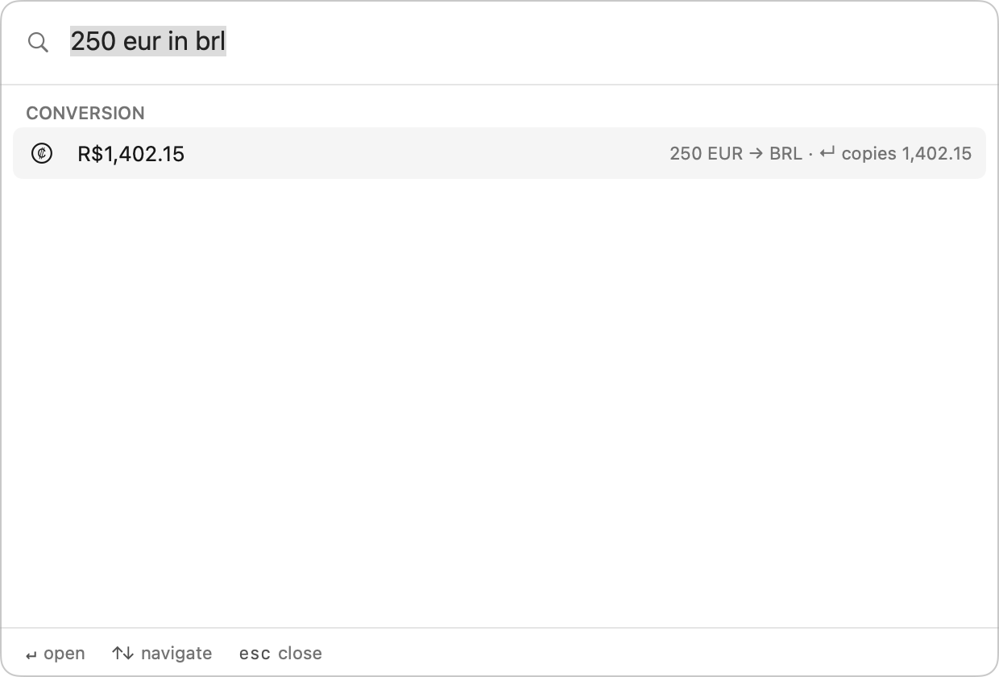
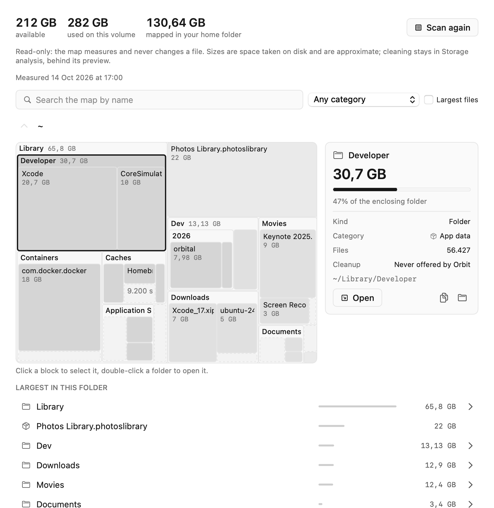

# Orbit

**Um app. Muitas ferramentas. Você decide o foco.**

Uma central de comando para o seu Mac, pensada para você não precisar abrir seis apps para dar conta de um dia. Escolha um workspace e o Orbit vira aquilo que você está fazendo agora: seus apps e pastas, suas tarefas, seu timer, a saúde do seu Mac.

[**Baixe a última versão**](../../releases/latest) · macOS 14 ou mais recente

[English](README.md) · **Português (BR)**

 

<picture>
  <source media="(prefers-color-scheme: dark)" srcset="images/dashboard-dark.png">
  
</picture>

## Seu foco, a um clique

O Orbit não é um utilitário de uma função só. É um hub com muitos cômodos, e **você escolhe qual fica aberto**.

- **Workspaces montam o cenário.** "Trabalho", "Estúdio", "Projeto paralelo": cada um é um conjunto de apps, pastas e links. Troque de workspace e tudo de que você precisa fica a um clique. Trocar nunca abre nada sozinho.
- **O painel da barra de menu é seu para arrumar.** Arraste os blocos na ordem que quiser, remova os que não usa e adicione de volta depois. Ele pode ter o seletor de workspace, favoritos, um conversor de moedas, leituras do Mac Health, um timer em andamento e o estado da área de transferência.
- **Uma paleta de comandos para tudo.** Aperte **⌃⌥Espaço** e digite: vá para um workspace, converta `100 eur in brl`, ache uma nota, crie uma tarefa, pergunte ao assistente.

<table>
<tr>
<td width="50%" valign="top">
<picture>
  <source media="(prefers-color-scheme: dark)" srcset="images/menubar-dark.png">
  
</picture>
 <b>O painel da barra de menu</b>, do seu jeito
</td>
<td width="50%" valign="top">
<picture>
  <source media="(prefers-color-scheme: dark)" srcset="images/palette-convert-dark.png">
  
</picture>
 <b>A paleta de comandos</b>: converter, buscar, pular
</td>
</tr>
</table>

## O que tem dentro

### Para dar conta do dia
- **Tarefas** com prazos escritos do jeito que você fala (português e inglês), **notas rápidas** e **snippets**, com exportação para o Obsidian e o Apple Notas.
- **Relógio**: timers de contagem regressiva (`25m`, `1h30`, `10:00`), um ciclo pomodoro com as durações que você quiser e relógios mundiais por cidade.
- **Moedas** com as taxas de referência diárias do BCE, guardadas para uso offline, e conta decimal exata (sem arredondamento de ponto flutuante).
- **Histórico da área de transferência**, opcional e local.
- **Widgets** de moeda, tarefas, favoritos, visão geral e relógio.

### Pergunte, por texto ou voz
- Um **assistente por regras** que entende comandos simples em português e inglês, digitados ou falados (segure **⌃⌥V**; o reconhecimento roda no aparelho).
- Um **painel de pesquisa com IA** opcional (**⌃⌥A**) que pode usar seu plano do **Claude** ou do **ChatGPT**, ou suas próprias chaves de API. A IA fica desligada até você ligar.
- Um companheiro opcional, o **[Conclave](https://github.com/carvalhobfr/conclave-ai)**, que abre o painel local de revisão dele para uma pasta que você autorizar.

### Cuide do seu Mac
- **Leituras ao vivo**: CPU, memória, armazenamento, bateria, rede, estado térmico.
- **Mapa do disco**: um treemap da sua pasta pessoal para você explorar, com progresso ao vivo durante a varredura e o último mapa guardado para abrir na hora.
- **Limpeza segura**: caches e pastas de build vão para o **Lixo**, nunca são apagados direto, e só depois de você revisar uma prévia e confirmar.

<picture>
  <source media="(prefers-color-scheme: dark)" srcset="images/health-map-dark.png">
  
</picture>

## Na próxima versão

Já pronto e em verificação antes de sair. Ainda não está no download atual.

- **Dispositivos.** Seu iPhone e iPad pelo cabo ou pela sincronização por Wi-Fi: saúde da bateria (carga, ciclos, capacidade máxima), armazenamento, apps por tamanho com os dados que cada um guarda, os backups do Finder neste Mac, um histórico de bateria e armazenamento por hora, um widget de bateria e um bloco na barra de menu, e notificações opcionais de bateria fraca e carregada. O padrão é só ler: nada é instalado, copiado ou pareado. Remover um app do celular é opcional, pede uma confirmação com o nome do app e recusa os apps da própria Apple.
- **Acessórios** (opcional): a carga dos seus AirPods, Magic Keyboard, Mouse e Trackpad, e controles de jogo.
- **Mais Mac Health:** um checkup (pressão de memória, travamentos, saúde do disco e da bateria, e verificações de proteção como FileVault, firewall, Gatekeeper, atualizações e Time Machine, cada uma com uma explicação simples); uma varredura inteligente que diz onde olhar primeiro; tamanho dos apps, último uso, desinstalação e checagem de atualizações (Sparkle, App Store e Homebrew); itens de inicialização e extensões do sistema; duplicados e arquivos grandes antigos; busca no mapa do disco, filtros por categoria, ranking dos maiores arquivos e discos externos.
- **Barra de menu e relógio:** um bloco "Apps mais ativos", presets de pomodoro (Clássico 25/5, Trabalho profundo 50/10, Sprint 15/3) e um som para cada timer.

## Princípios

- **Local primeiro.** Seus dados ficam no seu Mac. **Sem telemetria, sem contas, sem analytics.**
- **Primeiro ler, depois mudar.** As varreduras só medem. Tudo que remove algo é explícito, tem prévia e, quando possível, pode ser recuperado do Lixo.
- **Segredos ficam no Keychain**, nunca no banco de dados do app.
- **Nativo.** SwiftUI e AppKit, um design monocromático que respeita Reduzir Movimento e Aumentar Contraste, em inglês e português do Brasil.

## Instalação

1. Abra a [última versão](../../releases/latest) e baixe o `Orbit-<versão>.zip`.
2. Descompacte e mova o `Orbit.app` para a pasta **Aplicativos**.
3. Estes builds **não são notarizados pela Apple**, então na primeira vez que você abrir o Orbit o macOS vai recusar. Vá em **Ajustes do Sistema → Privacidade e Segurança** e escolha **Abrir Mesmo Assim**.

Requer **macOS 14 ou mais recente**.

## Bom saber

- **Atualizar:** o Orbit avisa quando sai uma versão mais nova (Ajustes → Atualizações) e abre a página da release. Baixe e substitua o app em Aplicativos. O Orbit nunca baixa nem instala nada sozinho.
- **As permissões são pedidas quando um recurso precisa delas**: notificações, microfone e Acesso Total ao Disco (só para mapear a pasta pessoal inteira sem avisos). O macOS pode pedir de novo depois de uma atualização.
- **Os widgets** mostram "Abra o Orbit para sincronizar" nestes builds, porque compartilhar dados com um widget exige um time de desenvolvedor da Apple na assinatura.

## Sobre este repositório

Este repositório guarda só os builds para download e esta página; o código-fonte é privado. A checagem de atualizações do Orbit lê a última release daqui. Cada release diz o que mudou e como instalar. As capturas de tela usam dados de exemplo.
